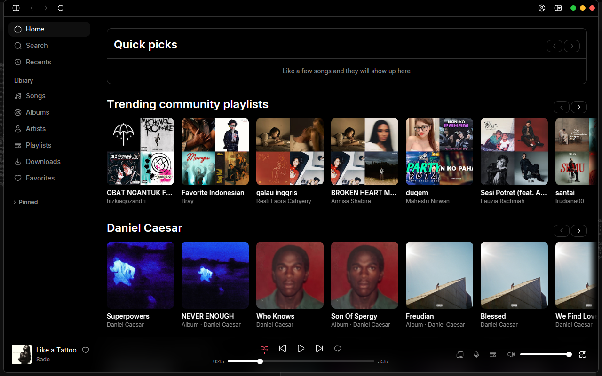
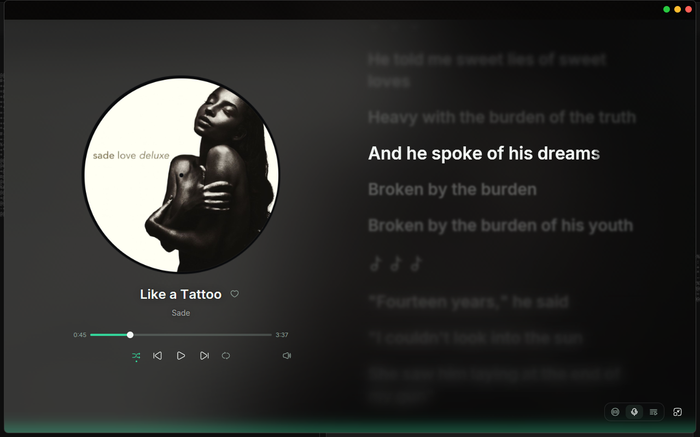
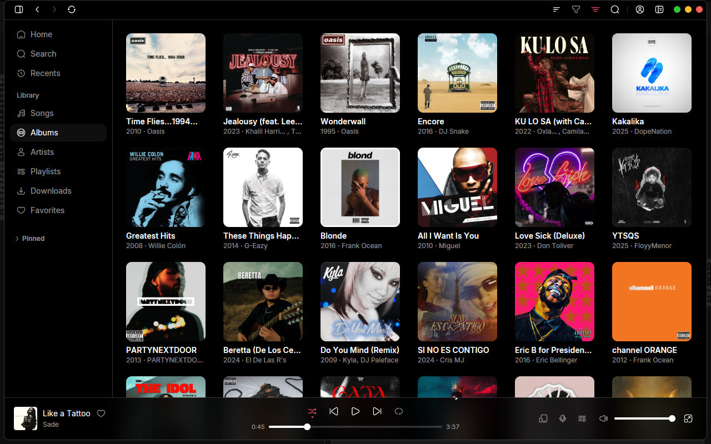
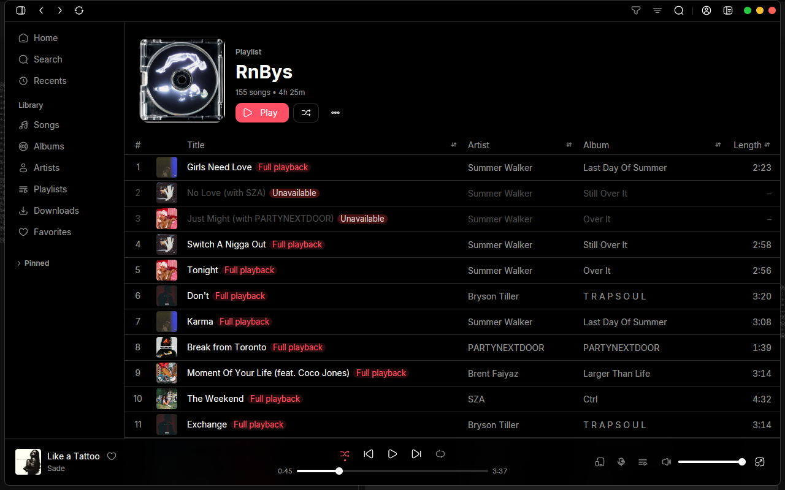

<div align="center">


<h1>Soundy</h1>

### A fast, native music player for Windows

**Local files and streaming, one library, no browser engine.**

[](https://github.com/ganddtn40/soundy/releases/latest)
[](https://github.com/ganddtn40/soundy/releases)
[](./COPYING)
[](#requirements)
[](https://www.rust-lang.org)

[Download](#download) · [Features](#features) · [Build from source](#build-from-source) · [Documentation](#documentation)

</div>

Soundy is a desktop music player written in Rust and rendered with
[GPUI](https://github.com/zed-industries/zed). It plays the music on your disk and streams from
the providers it supports through one consistent library, without Electron, a WebView shell or a
client-side JavaScript framework.

The player is built to feel immediate: a cold start measured at 213 ms, around 0.3 seconds of
CPU per idle minute, native window management and no background polling beyond what playback
needs. Those are measured numbers from the release build, not targets.

Soundy is designed, built and maintained by **[ganddtn40](https://github.com/ganddtn40)**.

> [!IMPORTANT]
> **Soundy is not a piracy tool.**
>
> Soundy does not obtain, share, export or decrypt copyrighted material. It does not bypass
> DRM, subscriptions, paywalls or the rules of the services it connects to. If a provider
> requires a valid subscription to play a track, Soundy requires one too. Features aimed at
> ripping, downloading or redistributing protected streams are out of scope.

## Download

Get the latest build from the [releases page](https://github.com/ganddtn40/soundy/releases/latest).

| Build | File | Notes |
| --- | --- | --- |
| Installer | `Soundy-1.0.0-Setup.exe` | Per-user install, Start menu shortcut, uninstaller |
| Portable | `Soundy-1.0.0-Portable.zip` | Unpack anywhere and run `soundy.exe` |

Both are built from the same release binary. The executable is unsigned, so Windows SmartScreen
may show a warning on first launch. Choose **More info**, then **Run anyway**.

### Requirements

- Windows 11 x64. This is the packaged and tested target.
- A Vulkan-capable graphics driver, as required by GPUI.
- No runtime, no .NET install and no WebView2 dependency.

Linux and macOS build paths remain in the source tree, but Soundy does not publish packages for
them yet.

## Features

**One library, local and streaming**

- Songs, Albums, Artists, Playlists, Downloads and Favorites in a single sidebar.
- Search with grouped results, best match and recent searches.
- Artist, album, playlist and genre pages with a shared artwork cache.
- Playback history and a queue that survives navigation.

**A player that stays out of the way**

- Gapless playback, crossfade where the provider supports it, and a real equalizer with
  profiles and per-device rules.
- Word-timed lyrics, a queue panel and a native spectrum visualizer.
- Fullscreen now-playing view with the cover presented as a vinyl record over a blurred
  artwork field.
- Global media keys, tray controls and optional Discord rich presence.

**Playlist import without an account**

- A Spotify playlist link, an M3U/M3U8 or CSV file, or a pasted track list.
- No Spotify account, Premium, OAuth or API key is required. A Spotify link is read through an
  existing Spotify session when one exists; without one the dialog says so and offers the file
  and paste paths instead of scraping.
- Imported rows keep their order and duplicate counts, get provider-matched metadata and
  artwork, and fall back to a generated 2x2 cover.

**Quiet by default**

- No telemetry, no installation counter and no update checker.
- No Soundy account and no Soundy server.
- Settings, playback state and caches live under `%APPDATA%\soundy` and `%LOCALAPPDATA%\soundy`.

## Screenshots

<div align="center">

| Home | Now playing |
| --- | --- |
|  |  |

| Library | Playlist |
| --- | --- |
|  |  |

</div>

Screenshots are from the 1.0.0 release build at 1280x800.

## Build from source

### Windows

Prerequisites:

- Rust stable with the MSVC toolchain
- Visual Studio Build Tools with the C++ workload, including CMake
- Inno Setup 6, for the installer only

From a Developer PowerShell in the repository root:

```powershell
cargo build --release -p sonora
```

The executable is `target\release\soundy.exe`. To build the installer and portable ZIP:

```powershell
.\scripts\windows\build-soundy-installer.ps1
```

Both land in `dist\`. The crate is still named `sonora` because the project keeps the upstream
package layout; the binary target is `soundy`.

### Linux and macOS

The workspace keeps the Linux and macOS build paths. Use Nix where available:

```sh
nix develop          # or: direnv allow
cargo run --locked --package sonora
```

Without Nix you need rustup, a C++ compiler, `cmake`, `pkg-config`, `mold`, and the development
packages for ALSA, D-Bus, fontconfig, libxkbcommon, libxcb, libX11 and SQLite. Running it also
needs a Vulkan driver.

## Playlist import

**+ -> Import playlist** on the Playlists screen opens one dialog with three sources.

| Source | Accepts | Account needed |
| --- | --- | --- |
| Spotify link | playlist URL or `spotify:playlist:` URI | Only if Spotify is already signed in |
| M3U or CSV file | `.m3u`, `.m3u8`, `.csv`, `.txt` | None |
| Pasted list | One track per line, `Artist - Title` or `Title \| Artist \| Album \| Duration` | None |

Every imported row keeps its position and duplicate count and ends with one honest status:
**Full playback**, **Full playback (local)**, **Preview only**, **External playback** or
**Unavailable**. Matching prefers your own files, then the active provider, then Audius (and
Jamendo when `SOUNDY_JAMENDO_CLIENT_ID` is set); a different recording is never substituted.
The full behaviour, formats and privacy notes are in [docs/IMPORTER.md](./docs/IMPORTER.md).

## Performance

The release build settles at **110.1 MB** working set with a **98.7 MB** private commit, uses
**0.344 s** of CPU per idle minute (about 0.6% of one core), and shows its window **213 ms**
after launch (median of three cold starts). Streaming measures 119.9 MB working / 99.4 MB
private.

The memory target is below 100 MB. Private commit meets it; resident memory is about 10 MB over,
and closing that gap would need a smaller renderer than GPUI's `wgpu` baseline. The method and
profile caveats are in [PERFORMANCE.md](./PERFORMANCE.md). No figure in this repository is
claimed without a real measurement.

## Documentation

- [docs/IMPORTER.md](./docs/IMPORTER.md) - sources, formats, matching and the Spotify limit
- [docs/ARCHITECTURE.md](./docs/ARCHITECTURE.md) - crates, the import path and threading
- [docs/FEATURE-COMPARISON.md](./docs/FEATURE-COMPARISON.md) - this build against Sonora
- [docs/MONOCHROME-PARITY.md](./docs/MONOCHROME-PARITY.md) - Monochrome features and their real status
- [docs/KNOWN-LIMITATIONS.md](./docs/KNOWN-LIMITATIONS.md) - limits stated plainly
- [docs/LICENSE-REPORT.md](./docs/LICENSE-REPORT.md) - dependency and licence summary
- [docs/TEST-RESULTS.md](./docs/TEST-RESULTS.md) - what was run and what passed
- [PERFORMANCE.md](./PERFORMANCE.md) - idle memory, CPU and startup measurements

## Contributing

Bug reports and feature requests go to [Issues](https://github.com/ganddtn40/soundy/issues).
General questions and show-and-tell go to
[Discussions](https://github.com/ganddtn40/soundy/discussions). Read
[CONTRIBUTING.md](./CONTRIBUTING.md) before a large pull request.

## Attribution and licence

Soundy is distributed under the **GNU General Public License v3.0 or later**. See
[COPYING](./COPYING) and [THIRD-PARTY.md](./THIRD-PARTY.md).

Soundy builds on [Sonora](https://github.com/sonorahq/sonora), which supplies the player engine,
provider integrations and native UI toolkit. The upstream copyright notices and GPL obligations
are preserved. The Soundy identity, emerald theme, focused sidebar, importer experience and
Windows packaging are this project's work.

Upstream credits that still apply:

- [Zed](https://github.com/zed-industries/zed) for GPUI
- [librespot](https://github.com/librespot-org/librespot) for Spotify playback
- [ytmusic-rs](https://github.com/sonorahq/ytmusic-rs) for YouTube Music
- The lyric, metadata and audio-decoding projects listed in [THIRD-PARTY.md](./THIRD-PARTY.md)

Provider names, service links and the Discord application id belong to Sonora and its
providers. They are kept because they are the real services and credentials this player uses;
they are not claimed as Soundy-owned.

## Code signing

Soundy has no code-signing certificate. Sonora's SignPath signing policy applies to binaries
built and signed by the Sonora project, not to builds made from this tree.
